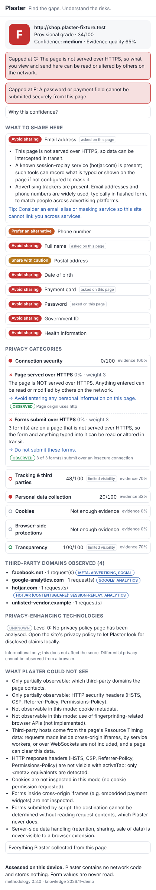

# Plaster

> **Find the gaps. Understand the risks. Make the internet safer.**

Plaster is a **local-first privacy assessment engine** with a **Chromium browser extension**. It tells ordinary users how privacy-friendly a website appears to be, what personal information to be careful about sharing there, and how confident it is. It also states plainly what it could *not* see.

It is built around one constraint: **a privacy tool must not itself become a privacy risk.** Plaster assesses pages entirely on the user's device. It contains no network code, stores nothing, and never reads what users type.

**Status: v0.1.0 (scoring methodology 0.3.0): an uncalibrated, fixture-tested prototype. Not production-ready. Scoring thresholds are judgement-based, and the extension has been tested only against local fixture pages, never live websites.** See [Implementation status](#implementation-status) and the [handover document](docs/HANDOVER.md).

<p align="center"></p>

<p align="center"><em>The extension assessing a local test fixture: an HTTP shop with a login form, session replay and advertising pixels.</em></p>

---

## What it does

For the current page, Plaster produces:

| Output | Description |
|---|---|
| **Privacy risk** | A score out of 100, an A–F grade, and traffic lights across six categories: connection security, tracking and third parties, personal data collection, cookies, browser-side protections, and transparency |
| **Evidence quality** | How much of the assessment rests on reliable evidence. Categories scored on limited evidence are marked *limited visibility*, so a green light is not mistaken for a verified one. |
| **Confidence** | High, medium or low. A medium-confidence grade is marked *provisional*. **At low confidence the grade is withheld** rather than guessed. |
| **Sharing guidance** | For nine kinds of personal data (email, phone, payment card, password, health and so on): *reasonable to share*, *share with caution*, *prefer an alternative* or *avoid sharing*, with reasons and a practical tip |
| **Explanations** | Every check shows its outcome, weight, explanation and the evidence it used. Each item of evidence is labelled **observed**, **disclosed**, **cached** or **unknown**. |
| **What Plaster could not see** | An explicit list of blind spots for this browser and permission level |
| **Privacy-enhancing technologies** | A separate, informational panel. Differential-privacy claims found on a privacy policy page are placed on an evidence ladder. They never affect the score, and vague wording like "anonymised" is never treated as differential privacy. |

## Privacy by design

These properties are **enforced by automated tests**, not just intended:

| Property | How it is enforced |
|---|---|
| **No form values or typed text are read** | The collector reads only field *structure* (`type`, `autocomplete`, `name`, page-authored label text). On privacy-policy pages it reads page-authored text only, skipping editable regions and form controls. The core validator allow-lists fields and drops anything else. Tests type a password, email and search term into a real page, and a full differential-privacy claim into a comment box, and assert that none of it appears in or affects the output. |
| **No network requests during assessment** | There is no network code at all. The core is compiled without DOM or Node types, so `fetch` doesn't even type-check. For the popup, the extension CSP (`default-src 'none'; connect-src 'none'`) blocks requests at runtime. The CSP does **not** cover the collector, which runs as a content script inside the page. There, static scans ban both direct network APIs and indirect request sinks (creating images or scripts, assigning `src`/`href`, navigation, workers). Integration tests watch the tab, the popup and a proxy carrying all browser traffic, and assert zero requests on both the normal and the privacy-policy code paths. A deliberately injected `fetch` makes that test fail. |
| **No browsing history is stored or transmitted** | The current page's origin and the hosts it contacted are the only location data retained. Paths and query strings are discarded inside the collector (tested with an identifier hidden in a tracking pixel's URL). Nothing is persisted, and the assessment disappears when the popup closes. |
| **Minimal permissions** | `activeTab` + `scripting` only: no host permissions, no `webRequest`, no `cookies`, no `storage`. Checked against an exact allow-list. |
| **Unknown never means safe** | Unobservable checks are never credited and reduce confidence. No grade is shown unless the tracking category was assessed and at least 75% of the assessment could be scored, so hidden trackers can't produce a good grade. The only exception is an observed insecure password or payment field, which always shows F. Property tests remove each signal in turn and assert that neither confidence nor the presented grade improves. One honest caveat: the numeric score itself can shift a few points when a minor category becomes unknown. That's inherent to any neutral score, and it's documented in [methodology §1.6](docs/scoring-methodology.md#16-what-unknown-is-neutral-does-and-does-not-guarantee). |
| **Explainable and versioned** | Every evidence reference must resolve (tested). Each assessment records its methodology, engine and knowledge-base versions. |
| **Online features are separate** | No online feature exists yet. The architecture reserves a single isolated package for consent-gated online features, and the [network egress register](docs/network-egress-register.md) must list any component before it can make a request. |

**Assurance levels.** Each claim above is in one of three categories:
- **Tested:** enforced by the automated tests listed under [Testing](#testing). This applies to every row of the table above, in Chromium only.
- **Documented assumptions:** Chromium's isolated world for content scripts, `activeTab` semantics, and the CSP applying to extension pages. These follow Chromium's documentation and have been exercised in the tests, but not independently audited.
- **Unverified:** behaviour on live websites, other Chromium versions, and Firefox.

See [`docs/review-2026-11.md`](docs/review-2026-11.md) §4.

## Architecture

```
apps/extension (Chromium MV3)           packages/core (pure TypeScript)        packages/knowledge
┌───────────────────────────┐           ┌─────────────────────────────┐        ┌──────────────────┐
│ popup  ──activeTab──▶ collector │ ─snapshot▶ │ validate ▶ context ▶ 18 checks │ ◀──────│ tracker seed     │
│ (render, textContent only)  │ ◀─result── │ ▶ categories ▶ confidence      │        │ public suffixes  │
└───────────────────────────┘           │ ▶ guidance ▶ explanations      │        └──────────────────┘
   browser APIs live ONLY here          └─────────────────────────────┘
                                         no DOM, no browser APIs, no I/O
```

- **`packages/core`** is the reusable engine. It takes a value-free `ObservationSnapshot` plus a `CapabilityProfile` (what the adapter could observe) and returns an `Assessment`. It is deterministic and has no dependencies. The capability profile is how the engine tells *"not present"* apart from *"not observable"*.
- **`packages/knowledge`** holds bundled, versioned reference data. In v0.1 this is a small hand-curated demonstration seed.
- **`apps/extension`** is the browser adapter and UI: a collector injected into the current tab on demand, and a popup that runs the engine locally.

More detail: [architecture](docs/architecture.md) · [what an extension can actually observe](docs/browser-capabilities.md) · [scoring methodology](docs/scoring-methodology.md) · [threat model](docs/threat-model.md).

## Implementation status

| Area | Status |
|---|---|
| Core engine: validation, evidence model, 18 checks, scoring, confidence, caps | ✅ Implemented |
| Command-line demo of the engine (`npm run demo:cli`) | ✅ Implemented |
| Personal-information sharing guidance (9 data types) | ✅ Implemented (rule-based) |
| Structural form-field classification | 🟡 Implemented, heuristic: English-centric name/label patterns |
| Chromium extension, `activeTab` tier | ✅ Implemented (fixture-tested only) |
| Privacy-policy PET and differential-privacy claim detection | 🟡 Partial: keyword heuristics, informational only |
| Tracker knowledge base | 🟡 Partial: ~40-domain demonstration seed, public-suffix subset |
| Scoring calibration against real sites | 🟡 Not yet: weights are explainable judgement calls |
| Enhanced observation (optional per-site `webRequest`: headers, cookies) | ⏳ Planned |
| Firefox support | ⏳ Planned |
| Local alternative suggestions | ⏳ Planned |
| Optional online alternative discovery (consent-gated) | ⏳ Planned, deliberately not started |
| AI-based analysis | ❌ Out of scope |

## Known limitations

- **Partial visibility.** Third-party hosts come from the page's Resource Timing data. This misses requests from cross-origin iframes, service workers and WebSockets, and a page can clear it. HTTP security headers and cookies are not visible in the `activeTab` tier. All of this is declared to the engine and shown to the user.
- **Not comprehensive tracker detection.** The bundled list is a small seed, so "none observed" is never presented as "none present".
- **Uncalibrated scoring:** weights, thresholds and caps are judgement calls, not validated against real websites (see [methodology §1.8](docs/scoring-methodology.md#18-known-limitations-of-030)).
- **Snapshot in time:** requests after the popup opens are not seen.
- **Main frame only:** forms inside cross-origin iframes, such as embedded payment widgets, are not inspected, and nor are forms inside web components (shadow DOM). Script-submitted forms are reported as *destination unknown*, because Plaster never reads request contents.
- **Full hostnames are kept** in the in-popup snapshot, so a per-user subdomain (e.g. `alice.example-saas.com`) would appear there. It never leaves the popup and is discarded when the popup closes.
- **Server-side behaviour is invisible:** retention, sharing and sale of data can't be observed by any browser extension.
- **Chromium only, and fixture-tested only:** the extension has not yet been evaluated on live websites.
- **Policy-page detection is a URL/title heuristic,** so a page such as `/account/privacy` is also scanned for claims. Only page-authored text is read, and only claim flags are kept.

## Running it

Requirements: **Node.js ≥ 22.18** (for built-in TypeScript type stripping).

```bash
npm ci
```

**Try the engine without a browser** (prints a readable report for a sample snapshot):

```bash
npm run demo:cli -- fixtures/snapshots/tracker-heavy-news.json
```

```bash
npm run demo:cli -- fixtures/snapshots/insecure-login.json
```

**Load the extension in Chrome or Chromium:**

```bash
npm run build:extension
```

Then open `chrome://extensions`, enable *Developer mode*, choose *Load unpacked*, and select `dist/extension`. Visit any website and click the Plaster toolbar button.

## Testing

```bash
npm run typecheck
```

```bash
npm test
```

```bash
npm run test:integration
```

| Suite | What it covers | Count |
|---|---|---|
| `npm test`: unit (`packages/core/test`) | Validation, domains, field classification, scoring, invariant I-8 and grade-display (Q-6) properties, guidance, DP ladder, determinism, explainability integrity, plus regression tests for review findings R1–R11 | 55 |
| `npm test`: static security (`tests/security`) | No network, DOM or storage APIs in core; no `.value`, `innerHTML`, network use or indirect request sinks in the extension; exact manifest permissions and CSP; production bundles free of test hooks, network primitives and HTML sinks; no runtime dependencies | 9 |
| `npm run test:integration` (`tests/integration`) | Real Chromium with the extension, against local fixture sites served by a recording proxy: assessment, secret non-collection, URL reduction, zero egress (normal and policy-page paths), CSP enforcement, policy-text reduction, typed text cannot influence claims | 9 |

The integration tests need Playwright with its Chromium build. They are skipped, with a message, if Playwright isn't installed. Because `activeTab` requires a real click, which automation can't perform, they use a **test build** with one extra host permission (`*.plaster-fixture.test`) and a test hook. A static test asserts that these are the *only* differences from the production build.

## AI-assisted development and human oversight

Plaster was built with AI assistance under human direction.

- **Direction and decisions.** The project owner conceived and directed Plaster, set its requirements and privacy invariants, and oversaw the architectural decisions. Decisions with security, privacy or architectural impact are the owner's. Choices made provisionally during implementation are recorded for explicit approval in [`docs/open-decisions.md`](docs/open-decisions.md), not adopted silently.
- **Implementation.** Code, tests and documentation were drafted with **Claude Code** (Anthropic) as the primary development assistant. Product and architecture questions were also discussed with a separate AI assistant.
- **Review and acceptance.** The owner reviews all changes, decides what is accepted, and performs all commits and pushes. The AI assistant does not commit. **The owner retains responsibility for the project and its claims.**
- **Verification over assertion.** The privacy properties above are enforced by automated tests. Mutation checks show that the key tests fail when a violation is introduced. A [review pass](docs/review-2026-11.md) found and corrected issues in the first implementation. Limitations are documented, not hidden: see [browser capabilities](docs/browser-capabilities.md), which separates *verified*, *documented* and *unverified* claims.

## Documentation

| Document | Purpose |
|---|---|
| [`docs/HANDOVER.md`](docs/HANDOVER.md) | **Start here:** what works, how to demo and test, limitations, security concerns, next steps |
| [`docs/review-2026-11.md`](docs/review-2026-11.md) | Review of v0.1: findings, fixes and residual issues |
| [`docs/architecture.md`](docs/architecture.md) | Component boundaries, implementation status, data flow |
| [`docs/browser-capabilities.md`](docs/browser-capabilities.md) | What a Chromium extension can and cannot observe (verified findings) |
| [`docs/scoring-methodology.md`](docs/scoring-methodology.md) | Part 1: methodology 0.3.0 as implemented (weights, caps, guarantees, limitations, changelog). Part 2: original design proposal |
| [`docs/threat-model.md`](docs/threat-model.md) | Assets, adversaries, threats and mitigation status |
| [`docs/invariants.md`](docs/invariants.md) | Non-negotiable security and privacy rules |
| [`docs/local-first-spec.md`](docs/local-first-spec.md) | Local-first and offline requirements |
| [`docs/network-egress-register.md`](docs/network-egress-register.md) | Every component that can make a network request (currently none) |
| [`docs/roadmap.md`](docs/roadmap.md) | Phased plan and current status |
| [`docs/open-decisions.md`](docs/open-decisions.md) | Owner decisions (approved and open) and their trade-offs |

## Licence

Plaster's own code, documentation and data are licensed under the [Apache License 2.0](LICENSE) (see also [`NOTICE`](NOTICE)).

Third-party material keeps its own licence. In particular, the public-suffix entries in `packages/knowledge/src/public-suffixes.ts` come from the Public Suffix List (MPL-2.0). The Apache License does not override third-party licences; see [`THIRD_PARTY_NOTICES.md`](THIRD_PARTY_NOTICES.md).
